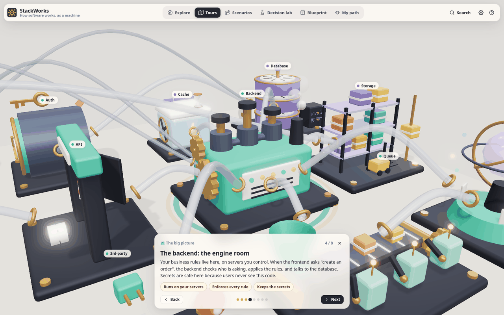
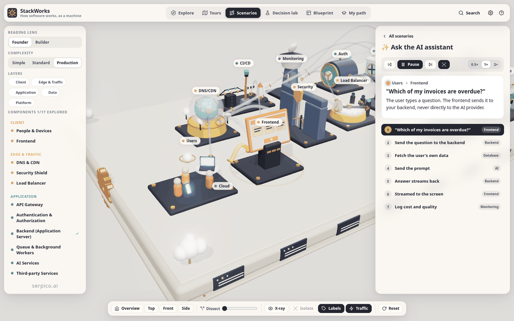
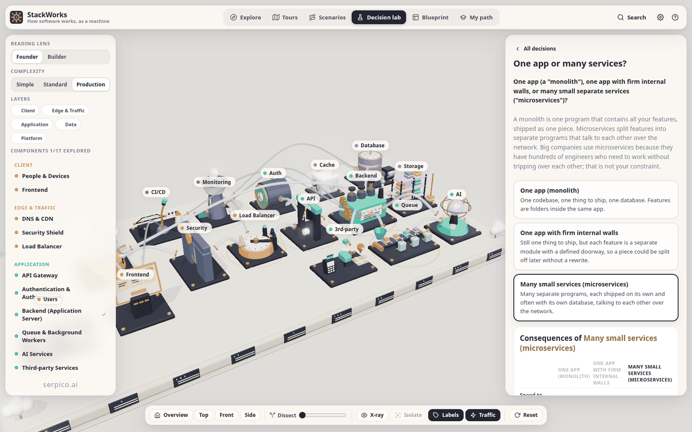
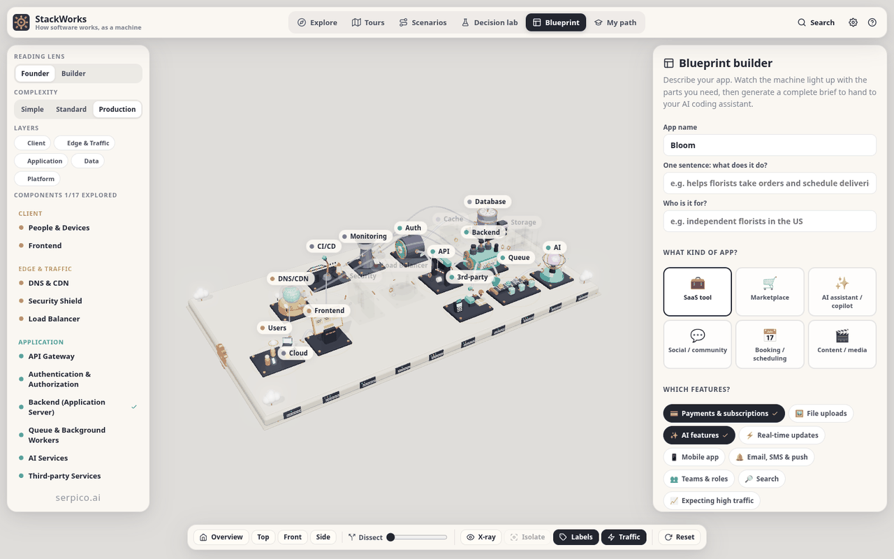
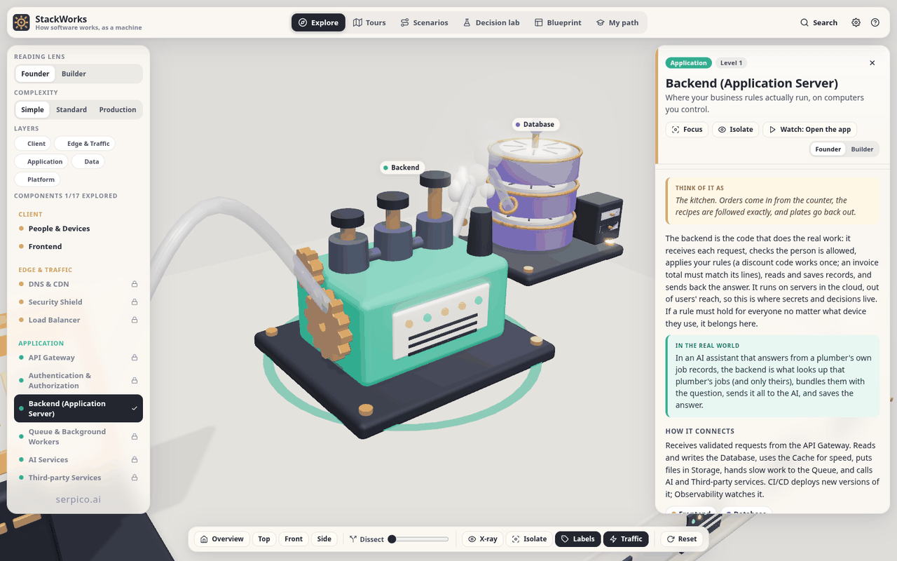

<h1 align="center">StackWorks</h1>

<p align="center"><strong>How software works, as a machine you can walk around, take apart, and run.</strong></p>

<p align="center">
  <a href="https://stackworks-dusky.vercel.app"><strong>▶ Open the exhibit</strong></a> ·
  <a href="#what-you-can-do">What you can do</a> ·
  <a href="#run-it-locally">Run it locally</a> ·
  <a href="#how-its-built">How it's built</a> ·
  <a href="#editing-the-content">Edit the content</a>
</p>

<p align="center">
  
  
  
  
  
  
</p>

<p align="center">
  <a href="https://stackworks-dusky.vercel.app"></a>
</p>

StackWorks is an interactive 3D museum exhibit for **nontechnical founders** who are about to have an AI write their software. It turns the modern client–server stack into a friendly mechanical machine: seventeen stations on a platform, connected by glass pipes, with requests travelling through them as glowing packets. Click any station and it tells you, in plain English, what it does, how it connects, what usually goes wrong, and **exactly what to ask your AI** when you build that part.

No sign-up. No backend. Nothing leaves your browser.

## Why it exists

Founders can now direct an AI to write 100% of their code. What they can't outsource is knowing what to ask for: that files need storage, that slow work goes on a queue, that secrets never live in the frontend, that a cache hit is not proof a write will succeed. Diagrams of boxes and arrows don't teach that. A machine you can explode, x-ray, grow, and watch run under load does.

## What you can do

| | |
|---|---|
| **Explore 17 stations** | People & devices, frontend, DNS/CDN, security, load balancer, API gateway, auth, backend, database, cache, storage, queue & workers, AI services, third-party APIs, observability, CI/CD, cloud. Each opens a story: purpose, connections, technologies and vendors, real-world examples, common mistakes, a quiz, and "Ask your AI" prompts for designing, building and verifying it. |
| **Switch reading lens** | **Founder** (default) is analogy-first, no unexplained jargon, with a small-business example and copy-paste prompts. **Builder** is the full technical version. One toggle, same machine. |
| **Dissect it** | A dissect slider separates the machine into layers. X-ray reveals the internals. Isolate dims everything but one part and its neighbours. Layer filters light up client, edge, application, data or platform. |
| **Grow it** | A complexity dial (Simple → Standard → Production) adds stations and pipes. Parts glide to new positions and the platform physically expands. |
| **Run 8 scenarios** | Open the app, sign up and log in, upload a photo, ask the AI assistant, buy something, ship a feature, something breaks at 3am, go viral. Requests hop station to station with narration, insights and takeaways. Routes get longer as the machine grows. |
| **Take 6 tours** | Narrated camera tours, from a 5-minute big picture to *Building it with AI*, the founder's workflow for directing an AI to write every line. |
| **Make 8 real decisions** | Hosting model, monolith vs microservices, database type, auth strategy, AI hosting, background work, caching, web vs mobile. Pick an option and watch its consequences in the machine and across five trade-off metrics. |
| **Build a blueprint** | Describe your app (archetype + features). The machine lights up with only the parts you need and generates a complete Markdown build brief to paste into Claude Code, Cursor or any AI coding assistant. |
| **Follow a learning path** | Three levels (Explorer → Builder → Architect) with missions. Finishing a level unlocks the next, bigger machine. Progress stays in `localStorage`. |

<p align="center">
  
  
</p>
<p align="center">
  
  
</p>

## Run it locally

Requires Node.js 20+.

```bash
git clone https://github.com/VincentAZ/SWFactory2.git
cd SWFactory2
npm install
npm run dev          # http://localhost:5173
```

| Command | What it does |
|---|---|
| `npm run dev` | Vite dev server with hot reload |
| `npm run build` | Type-checks (`tsc --noEmit`), then bundles to `dist/` |
| `npm run preview` | Serves the production build on http://localhost:4173 |
| `npm test` | Content-integrity tests (`node --test`): every pipe, scenario step, decision and mission references a real component; Founder copy meets the sentence and jargon rules |
| `npm run shots` | Headless visual smoke test: drives every mode and screenshots it to `/tmp/sw-shots` (needs Google Chrome at `/usr/bin/google-chrome` and `npm run preview` running) |

Deep links work out of the box: `?focus=backend`, `?mode=scenarios`, `?mode=decisions`, `?mode=blueprint`, `?level=3`.

### Keyboard

| Key | Action | Key | Action |
|---|---|---|---|
| `/` | Search | `X` | X-ray |
| `?` | Help | `E` | Explode / dissect |
| `1` `2` `3` | Complexity level | `I` | Isolate selection |
| `←` `→` | Previous / next tour or scenario step | `L` | Toggle labels |
| `Space` | Play / pause | `F` | Ambient traffic |
| `R` | Reset camera | `Esc` | Close / exit |

## How it's built

- **Three.js, procedural everything.** Every station is assembled from primitives in code (`src/three/parts/`). No external models, no textures, no asset downloads. Soft shadows, a room environment for reflections, and a bloom pass so packets glow.
- **TypeScript + Vite, no UI framework.** A small store (`src/app/store.ts`) is the single source of truth; the 3D scene and the DOM panels both subscribe to it. Total source is under 10k lines.
- **Content is data.** All educational copy lives in `src/content/` as typed objects, which is why the tests can prove every reference resolves.
- **Performance budget.** Instanced packets, cached geometries, capped pixel ratio, and adaptive quality that drops resolution and then bloom if the frame rate sags. Rendering pauses when the tab is hidden. `prefers-reduced-motion` is respected.
- **Private by design.** No backend, no analytics, no cookies. Progress and the reading-lens choice are the only things stored, in `localStorage`.
- **Deployed on Vercel** as a static site (`vercel.json`), assets cached immutable.

```
src/
  main.ts       boot: scene, store, panels, URL params, keyboard
  app/          store, actions, scenario player, tour player, types
  three/        scene & post-processing, machine assembly, parts/, pipes, packets, labels, interaction
  content/      components (A/B/C), founder-lens copy, glossary, scenarios, tours, decisions, blueprint, levels
  ui/           DOM panels: inspector, tours, scenarios, decision lab, blueprint, learning path, chrome, overlays, lens
  styles/       base.css (stage, labels) and ui.css (panels, controls)
tests/          content-integrity tests
scripts/        headless visual smoke test
docs/           screenshots used in this README
```

## Editing the content

Everything a learner reads is in `src/content/`. You never need to touch the 3D code to change what the exhibit teaches.

- **Builder lens** (technical copy) is in `componentsA/B/C.ts`. Each component has `tagline`, `analogy`, `purpose`, `howItConnects`, `tech` groups with vendors, `examples`, `mistakes`, `askAi` groups (Designing / Building / Verifying) and `quiz` questions.
- **Founder lens** (the default) is in `founder.ts`, keyed by component id: `tagline`, `analogy`, `description` (2–3 sentences), `realWorld`, and 2–3 `askAi` prompts. The test suite enforces the sentence count and flags unexplained acronyms.
- **Tours, scenarios and decisions** have a single copy written to the same standard: any term a Salesforce-literate non-engineer wouldn't know is explained inline on first use. Scenarios are lists of steps (`from`, `to`, packet `kind`, `narration`, optional `insight`); the machine routes each step through whatever pipes exist at the current complexity level, so one scenario works at all three sizes.
- **Levels** (`levels.ts`) define missions by referencing tour, scenario and decision ids.

Run `npm test` after editing. It fails loudly on a broken reference.

## License

MIT. See [LICENSE](LICENSE).

---

<p align="center">Built by <a href="https://serpico.ai">Serpico AI</a> in Phoenix, Arizona.</p>
